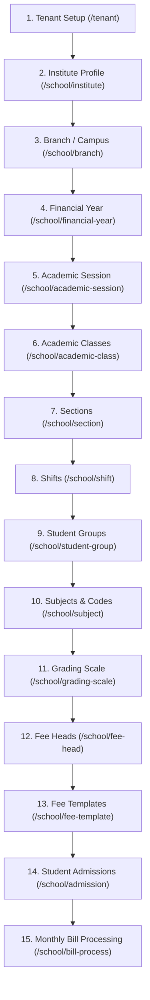

# EDUGATES School Management System (ERP)
## Comprehensive Administrator Manual, Process Flow & System Setup Guide

> **Official PDF Download:**  
> The complete vector-rendered, 9-page executive PDF manual has been generated and is ready to download or view at:  
> **[EDUGATES_SMS_Admin_User_Manual_and_Setup_Guide.pdf](file:///d:/Company/Eninas/Projects/Noman/SchoolManagementSystem/EDUGATES_SMS_Admin_User_Manual_and_Setup_Guide.pdf)**

---

## 1. System Overview & Technology Stack

**EDUGATES School Management System** is a multi-tenant, multi-branch ERP engineered with Clean Architecture:

* **Frontend:** Angular SPA with PrimeNG responsive UI components.
* **API Gateway & Controllers:** ASP.NET Core Web API with Swagger and JWT Bearer security.
* **Application Core:** MediatR (CQRS Pattern) with separated Commands, Queries, and Handlers.
* **Persistence & ORM:** Entity Framework Core with Microsoft SQL Server.
* **PDF Vector Engine:** QuestPDF Native Vector Engine (v2024.12).
* **Integrations:** Biometric attendance machine sync, SMS gateway, and bKash / PayBill payment callbacks.

---

## 2. How to Run the Whole System (Step-by-Step)

### Prerequisites
* Windows 10/11 or Windows Server
* .NET SDK 9.0 or 10.0
* Node.js v18+ & npm
* Microsoft SQL Server (SQL Express / LocalDB / Standard) & SSMS

### Step 1: Database Setup & Seeding
1. Open [appsettings.json](file:///d:/Company/Eninas/Projects/Noman/SchoolManagementSystem/SchoolManagementSystem.API/appsettings.json) and verify your SQL Server connection string:
   ```json
   "ConnectionStrings": {
     "DefaultConnection": "Server=YOUR_SERVER_NAME;Database=PersonalImpDBV3;Trusted_Connection=True;TrustServerCertificate=True"
   }
   ```
2. Apply Entity Framework Core database migrations:
   ```powershell
   dotnet ef database update --project SchoolManagementSystem.Infrastructure --startup-project SchoolManagementSystem.API
   ```
3. Execute the master SQL script to populate roles, sitemaps, permissions, and the default Super Admin:
   * Script file: [run with insert supper admin showkat4273@gmail.com pass 123456.sql](file:///d:/Company/Eninas/Projects/Noman/SchoolManagementSystem/run%20with%20insert%20supper%20admin%20showkat4273@gmail.com%20pass%20123456.sql)

> [!IMPORTANT]
> **Default Super Admin Login:**  
> • **Email:** `showkat131080@gmail.com` (or `showkat4273@gmail.com`)  
> • **Password:** `123456`  
> • **Role:** Super Admin (Full permissions across all branches, sitemaps, and features)

---

### Step 2: Run the Backend Web API
1. Navigate to the API project directory and run:
   ```powershell
   cd d:\Company\Eninas\Projects\Noman\SchoolManagementSystem\SchoolManagementSystem.API
   dotnet run
   ```
2. The Web API will launch at: `http://localhost:5015`
3. Verify API health and endpoints in Swagger: `http://localhost:5015/swagger`

---

### Step 3: Run the Frontend ClientApp (Angular)
1. In a new terminal window, navigate to the frontend directory:
   ```powershell
   cd d:\Company\Eninas\Projects\Noman\SchoolManagementSystem\ClientApp
   npm install
   npm start
   ```
2. The web application will launch at: `http://localhost:4200`
3. Open `http://localhost:4200` in your browser and sign in using the Super Admin credentials.

---

## 3. Master Administrator Configuration Workflow

Follow this **mandatory sequence** when setting up a new institute to prevent foreign key errors:



---

## 4. Operational Modules & Procedures

### A. Student Enrollment & Excel Bulk Upload
* **Single Admission:** Open `/school/admission`, select Branch, Class, Section, Shift, Group, enter Guardian information, upload photo, and save.
* **Bulk Import:** Open `/school/student-list`, click **Download Sample Excel** (or use [TestStudentUpload.xlsx](file:///d:/Company/Eninas/Projects/Noman/SchoolManagementSystem/TestStudentUpload.xlsx)), populate records, and click **Upload Student Excel**.

### B. Fee Management & Billing Lifecycle
1. **Fee Templates (`/school/fee-template`):** Group Fee Heads (Tuition, Exam, Lab, Sports) into class pricing templates.
2. **Bill Process (`/school/bill-process`):** Generate monthly batch student invoices by Class and Session.
3. **Counter Collection (`/school/bill-collection`):** Search student by ID/Roll, collect payment, and print 2-copy receipt.
4. **Multi-Month Collection (`/school/multi-month-bill-collection`):** Collect advance fees across several consecutive months in a single transaction.

### C. Examinations & Admit Cards
* **Marks Entry (`/school/student-mark-entry`):** Enter CQ, MCQ, and Practical marks. GPA points and letter grades calculate automatically.
* **Admit Cards:** Generates printable cards with photo, barcode, and schedule. The system checks unpaid tuition dues before issuing admit cards (with admin waiver override).

### D. Accounting & Financial Ledgers
* **Cashbook (`/school/cashbook`):** Tracks daily counter collections and minor expenses.
* **Bankbook (`/school/bankbook`):** Reconciles bank deposits and online gateways.
* **Trial Balance (`/school/trial-balance`):** Instantaneous equilibrium across all ledgers.
* **Income Statement (`/school/income-statement`):** Real-time revenue vs operational expenses.
* **Balance Sheet (`/school/balance-sheet`):** Institution assets, accumulated funds, and liabilities.

---

## 5. Troubleshooting & Maintenance

| Issue | Cause | Solution |
| :--- | :--- | :--- |
| **SQL Connection Failed** | Instance name incorrect or TCP/IP disabled | Check `DefaultConnection` in `appsettings.json`. Enable TCP/IP in SQL Configuration Manager. |
| **401 Unauthorized** | JWT token expired | Log out and re-login to refresh the Bearer token. |
| **Port 5015 in Use** | Orphan background process holding port | Run `Get-Process -Id (Get-NetTCPConnection -LocalPort 5015).OwningProcess \| Stop-Process`. |
| **Admit Card Blocked** | Outstanding student tuition due | Settle student dues or toggle `IgnoreDueCheck` in admin settings. |
