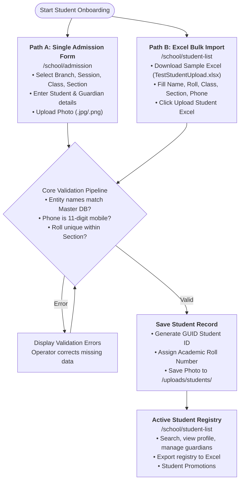
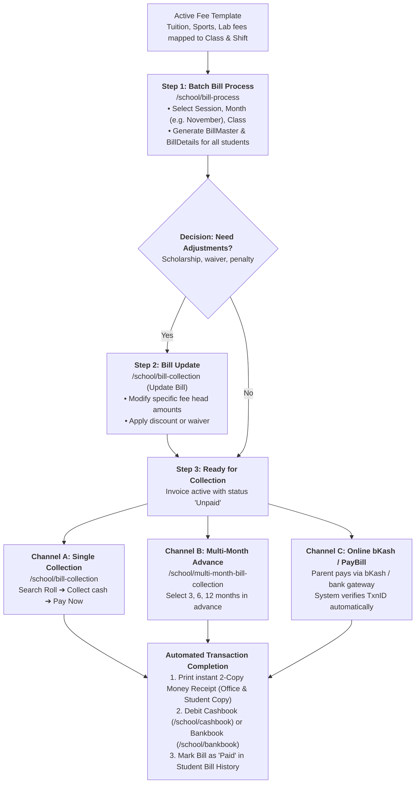
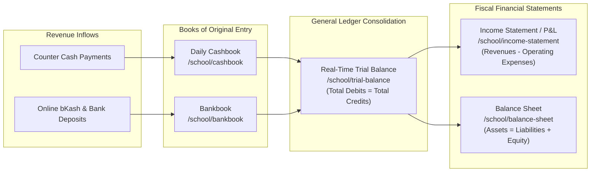
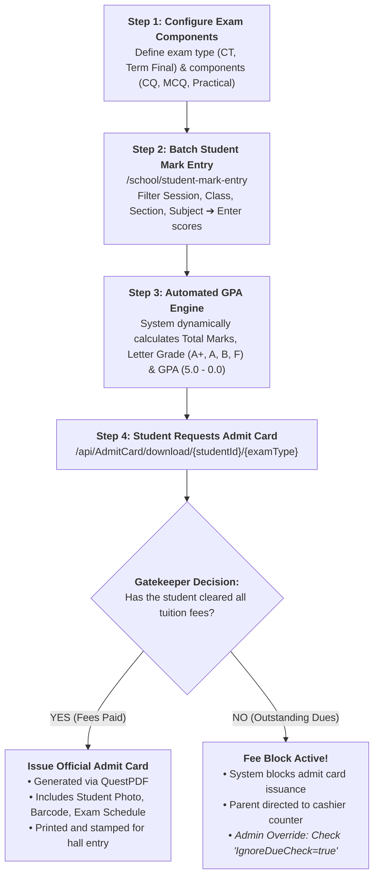
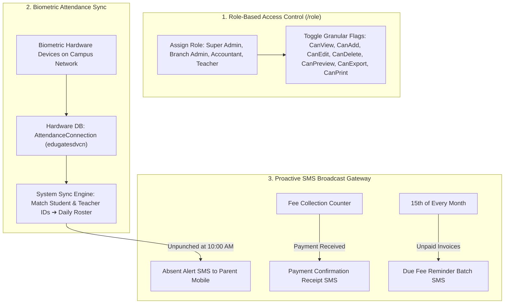

# EDUGATES School Management System (ERP)
## Administrator Process Flow & Visual Diagram Guide

> **Official PDF Download:**  
> The complete 9-page vector-rendered visual diagram manual has been generated and is ready to download or view at:  
> **[EDUGATES_SMS_Admin_Process_Flow_Diagram_Guide.pdf](file:///d:/Company/Eninas/Projects/Noman/SchoolManagementSystem/EDUGATES_SMS_Admin_Process_Flow_Diagram_Guide.pdf)**

---

## 1. Master High-Level Administrator Process Pipeline

```mermaid
flowchart TD
    P1["<b>PHASE 01: Secure Login</b><br/>Input credentials, JWT verification, Branch context active<br/><i>(/auth/login)</i>"]
    P2["<b>PHASE 02: Master Setup</b><br/>Institute ➔ Branch ➔ FY ➔ Session ➔ Class ➔ Section ➔ Shift ➔ Fee Templates<br/><i>(/school/master)</i>"]
    P3["<b>PHASE 03: Student Onboarding</b><br/>Interactive Admission Form OR Excel Bulk Import ➔ Active Student Registry<br/><i>(/school/admission & /school/student-list)</i>"]
    P4["<b>PHASE 04: Billing Lifecycle</b><br/>Batch Bill Process ➔ Invoices ➔ Bill Update / Waivers ➔ Active Due Invoices<br/><i>(/school/bill-process & /school/bill-collection)</i>"]
    P5["<b>PHASE 05: Collections & Receipts</b><br/>Cash Counter OR Multi-Month Advance OR bKash ➔ 2-Copy Money Receipts<br/><i>(/school/bill-collection & /school/multi-month-bill-collection)</i>"]
    P6["<b>PHASE 06: Financial Accounting</b><br/>Cashbook & Bankbook ➔ General Ledger ➔ Trial Balance, P&L, Balance Sheet<br/><i>(/school/cashbook & /school/trial-balance)</i>"]
    P7["<b>PHASE 07: Exams & Admit Cards</b><br/>Exam Components ➔ Mark Entry & GPA ➔ Fee Gatekeeper ➔ Official Admit Card<br/><i>(/school/student-mark-entry & /api/AdmitCard)</i>"]
    P8["<b>PHASE 08: Daily Ops & Security</b><br/>Biometric Device Punch Sync ➔ Absent SMS to Parents ➔ RBAC Permissions<br/><i>(/api/AttendanceDevice & /home/gs)</i>"]

    P1 --> P2
    P2 --> P3
    P3 --> P4
    P4 --> P5
    P5 --> P6
    P6 --> P7
    P7 --> P8
```

---

## 2. Phase 1 & 2: Administrator Login & Master Setup Dependency Workflow

```mermaid
flowchart LR
    subgraph Auth["Phase 1: Login & Context Selection"]
        L1["Admin Credentials<br/>showkat131080@gmail.com"] --> L2["API Issues JWT Token<br/>Resolves Role Menus"]
        L2 --> L3["Select Active Branch<br/>(Locks TenantId & BranchId)"]
    end

    subgraph Master["Phase 2: Master Setup Sequential Order"]
        M1["1. Tenant"] --> M2["2. Institute"]
        M2 --> M3["3. Branch"]
        M3 --> M4["4. Financial Year"]
        M4 --> M5["5. Academic Session"]
        M5 --> M6["6. Classes"]
        M6 --> M7["7. Sections"]
        M7 --> M8["8. Shifts"]
        M8 --> M9["9. Student Groups"]
        M9 --> M10["10. Subjects"]
        M10 --> M11["11. Grading Scale"]
        M11 --> M12["12. Fee Heads"]
        M12 --> M13["13. Fee Templates"]
    end

    L3 --> M1
```

---

## 3. Phase 3: Student Onboarding Flowchart (Single Admission vs. Excel Bulk Import)

---

## 4. Phase 4: Billing Lifecycle, Bill Updates & Collection Channels

---

## 5. Phase 5: Financial Accounting Flowchart

---

## 6. Phase 6: Examinations, Marks Entry & Fee-Gated Admit Cards

---

## 7. Phase 7: Role Permissions (RBAC), Biometric Devices & Automated SMS

